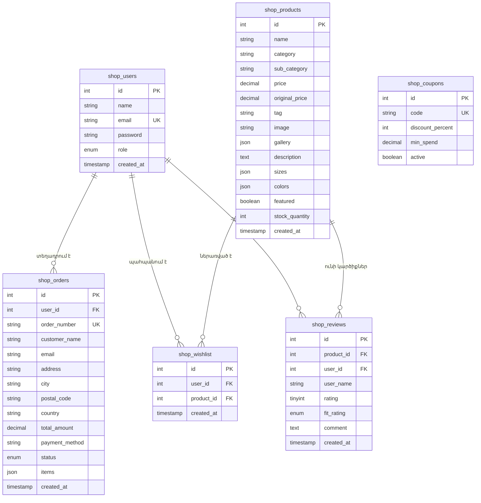

# AURA / ARCHIVE — Բարձրակարգ Էլեկտրոնային Առևտրի Համակարգ (Nike x Zara)

**AURA / ARCHIVE**-ը Full-Stack ժամանակակից eCommerce վեբ-հավելված է, որը միավորում է **Nike**-ի սպորտային արտադրողականության և արագ գործողությունների UX փորձառությունը **Zara**-ի մինիմալիստական էդիտորիալ դիզայնի, տպագրական ոճի (`Syne` + `Inter`) և մոնոքրոմ գունային գամմայի հետ։

Համակարգն աշխատում է **MySQL** տվյալների բազայի, **Node.js / Express** բեքենդի և **React 19 + Vite** ֆրոնտենդի հիման վրա։

---

## 📑 Բովանդակություն
1. [Նախագծի Կառուցվածքը (Project Structure)](#1-նախագծի-կառուցվածքը-project-structure)
2. [MySQL Տվյալների Բազայի Մանրամասն Նկարագրություն](#2-mysql-տվյալների-բազայի-մանրամասն-նկարագրություն)
   - [Բազայի Պարամետրեր](#բազայի-պարամետրեր)
   - [Աղյուսակների Սխեմաներ և Կապեր (Tables & Schemas)](#աղյուսակների-սխեմաներ-և-կապեր-tables--schemas)
   - [Նախնական Տվյալներ (Seed Data) և Մուտքային Տվյալներ](#նախնական-տվյալներ-seed-data-և-մուտքային-տվյալներ)
   - [SQL Կոդերի Գործարկում (Import database.sql)](#sql-կոդերի-գործարկում-import-databasesql)
3. [Ֆունկցիոնալ Հնարավորություններ (Key Features)](#3-ֆունկցիոնալ-հնարավորություններ-key-features)
   - [Բազմաչափ Ֆիլտրացիայի Համակարգ (Full Filters)](#բազմաչափ-ֆիլտրացիայի-համակարգ-full-filters)
   - [Ամբողջական Ադմինիստրատիվ Վահանակ (Full Admin Panel)](#ամբողջական-ադմինիստրատիվ-վահանակ-full-admin-panel)
   - [Զամբյուղ և Վճարում (Cart & Checkout)](#զամբյուղ-և-վճարում-cart--checkout)
   - [Ցանկությունների Ցուցակ (Wishlist) և Կտրոններ (Coupons)](#ցանկությունների-ցուցակ-wishlist-և-կտրոններ-coupons)
   - [Կարծիքներ և Չափսի Գնահատում (Reviews & Fit Ratings)](#կարծիքներ-և-չափսի-գնահատում-reviews--fit-ratings)
4. [Ինչպես Գործարկել Նախագիծը (How to Run)](#4-ինչպես-գործարկել-նախագիծը-how-to-run)

---

## 1. Նախագծի Կառուցվածքը (Project Structure)

Նախագիծը բաժանված է երկու հիմնական միջավայրերի՝ **`server`** (Բեքենդ API) և **`client`** (Ֆրոնտենդ UI), ինչպես նաև արմատային MySQL ֆայլերի՝

```text
college_website_app/
├── database.sql                     # Ամբողջական SQL սկրիպտ (բազայի ստեղծում, աղյուսակներ, 32 ապրանք, կտրոններ, ադմին)
├── MYSQL_COMMANDS_PER_PAGE.md       # Բոլոր SQL հարցումների մանրամասն ուղեցույց ըստ էջերի
├── README.md                        # Նախագծի գլխավոր փաստաթուղթ (հայերեն)
│
├── server/                          # Node.js + Express + MySQL Բեքենդ
│   ├── .env                         # Շրջակա միջավայրի փոփոխականներ (DB_HOST, PORT, DB_NAME, JWT_SECRET)
│   ├── db.js                        # MySQL Pool կապ, ավտոմատ initDB() և 32 ապրանքների սերմացում (seed)
│   ├── server.js                    # Express REST API բոլոր երթուղիներով (Auth, Products, Orders, Admin, Filters)
│   └── package.json                 # Բեքենդի կախվածություններ (express, mysql2, cors, bcryptjs, jsonwebtoken)
│
└── client/                          # React 19 + Vite Ֆրոնտենդ
    ├── index.html                   # HTML հիմնական կմախք (Google Fonts: Syne, Inter)
    ├── vite.config.js               # Vite կոնֆիգուրացիա
    ├── package.json                 # Ֆրոնտենդի կախվածություններ (lucide-react, react, react-dom)
    └── src/
        ├── main.jsx                 # React գործարկման կետ
        ├── App.jsx                  # Գլխավոր կոմպոնենտ (ֆիլտրեր, վիճակների կառավարում, մոդալ պատուհաններ)
        ├── App.css                  # Ոճավորում (Zara x Nike էսթետիկա, ադմին վահանակ, ֆիլտրերի վահանակ)
        ├── api.js                   # Բոլոր HTTP հարցումները դեպի բեքենդ (Fetch API)
        └── components/              # Վերաօգտագործելի React բաղադրիչներ
            ├── Navbar.jsx           # Վերին նավիգացիա (տիկեր, որոնում, զամբյուղի հաշվիչ, ադմին կոճակ, պրոֆիլ)
            ├── Hero.jsx             # Գլխավոր էդիտորիալ պաստառ (Campaign Video/Image banner)
            ├── FilterBar.jsx        # Բազմաչափ ֆիլտրման վահանակ (գներ, չափսեր, գույներ, թեգեր, զեղչեր)
            ├── ProductCard.jsx      # Ապրանքի քարտ (Hover էֆեկտներ, թեգեր, արագ դիտում, wishlist)
            ├── ProductModal.jsx     # Ապրանքի արագ դիտման պատուհան (պատկերասրահ, չափս, գույն, կարծիքներ)
            ├── CartDrawer.jsx       # Կողային սահող զամբյուղ (անվճար առաքման առաջընթացի սանդղակ)
            ├── CheckoutModal.jsx    # Վճարման պատուհան (հասցե, կտրոնի կիրառում, քարտի սիմուլյացիա)
            ├── AuthModal.jsx        # Մուտք և Գրանցում (JWT նշաններով)
            ├── OrdersModal.jsx      # Հաճախորդի պատվերների պատմություն և անդորրագրեր
            ├── WishlistModal.jsx    # Հաճախորդի պահպանված նախընտրելի ապրանքներ
            ├── AdminModal.jsx       # Ամբողջական Ադմին Վահանակ (KPI, ապրանքների CRUD, պատվերներ, օգտատերեր)
            └── Footer.jsx           # Կայքի ստորին հատված (նորություններ, բրենդային տեղեկատվություն)
```

---

## 2. MySQL Տվյալների Բազայի Մանրամասն Նկարագրություն

### Բազայի Պարամետրեր
- **Տվյալների Բազայի Անունը (Database)**: `college_db`
- **Նախնական Հոսթ և Պորտ (Host/Port)**: `localhost:3321` (կամ ստանդարտ `3306`)
- **Կոդավորում (Encoding)**: `utf8mb4` | **Collation**: `utf8mb4_unicode_ci`
- **Շարժիչ (Engine)**: `InnoDB` (ապահովում է ACID տրանզակցիաներ և արտաքին բանալիների `FOREIGN KEY` ամբողջականություն)

---

### Աղյուսակների Սխեմաներ և Կապեր (Tables & Schemas)

Տվյալների բազան բաղկացած է **6 հիմնական փոխկապակցված աղյուսակներից**՝



#### 1. `shop_users` (Օգտատերեր և Ադմինիստրատորներ)
Պահպանում է օգտատերերի հաշիվները։ Գաղտնաբառերը ապահով հեշավորվում են `bcryptjs`-ով (salt rounds = 10)։
- `id`: INT AUTO_INCREMENT PRIMARY KEY
- `name`: VARCHAR(255) — Օգտատիրոջ անունը
- `email`: VARCHAR(255) UNIQUE — Էլ․ հասցե (մուտքի համար)
- `password`: VARCHAR(255) — Հեշավորված գաղտնաբառ
- `role`: ENUM('customer', 'admin') DEFAULT 'customer' — Դերը համակարգում
- `created_at`: TIMESTAMP DEFAULT CURRENT_TIMESTAMP

#### 2. `shop_products` (Ապրանքների Կատալոգ)
Պահպանում է ապրանքների ամբողջական տվյալները, պատկերասրահները, գույները, չափսերը և պահեստային քանակը։
- `id`: INT AUTO_INCREMENT PRIMARY KEY
- `name`: VARCHAR(255) — Ապրանքի անվանումը
- `category`: VARCHAR(100) — Հիմնական կատեգորիան (`Men`, `Women`, `Footwear`, `Outerwear`, `Accessories`)
- `sub_category`: VARCHAR(100) — Ենթակատեգորիան (`Footwear`, `Outerwear`, `Apparel`, `Accessories`)
- `price`: DECIMAL(10, 2) — Ընթացիկ վաճառքի գինը
- `original_price`: DECIMAL(10, 2) NULL — Սկզբնական գինը (զեղչերի հաշվարկի համար)
- `tag`: VARCHAR(50) — Էդիտորիալ թեգ (`JUST RELEASED`, `STUDIO EDITION`, `BESTSELLER`, `ICONIC`, `LIMITED RUN`)
- `image`: VARCHAR(1000) — Հիմնական բարձրորակ նկարի հղումը
- `gallery`: JSON — Բազմակողմանի նկարների զանգված (Multi-angle photos)
- `description`: TEXT — Մանրամասն նկարագրություն և նյութի կազմություն
- `sizes`: JSON — Հասանելի չափսերի ցուցակ (օր․ `["US 8", "US 9", "US 10"]` կամ `["S", "M", "L", "XL"]`)
- `colors`: JSON — Հասանելի գույների անվանումներ
- `featured`: BOOLEAN DEFAULT FALSE — Ցուցադրե՞լ գլխավոր էջի առաջարկվող բաժնում
- `stock_quantity`: INT DEFAULT 50 — Առկա մնացորդը պահեստում
- `created_at`: TIMESTAMP DEFAULT CURRENT_TIMESTAMP

#### 3. `shop_orders` (Պատվերներ և Վճարումներ)
Պահպանում է կատարված բոլոր պատվերները, հասցեները և պատվիրված ապրանքների ցուցակը։
- `id`: INT AUTO_INCREMENT PRIMARY KEY
- `user_id`: INT NULL (FOREIGN KEY -> `shop_users(id)` ON DELETE SET NULL)
- `order_number`: VARCHAR(64) UNIQUE — Պատվերի համարը (օրինակ՝ `NZ-882194`)
- `customer_name`: VARCHAR(255) — Գնորդի լրիվ անունը
- `email`: VARCHAR(255) — Կոնտակտային էլ․ հասցեն
- `address`, `city`, `postal_code`, `country`: Առաքման հասցեի դաշտեր
- `total_amount`: DECIMAL(10, 2) — Ընդհանուր գումարը
- `payment_method`: VARCHAR(50) DEFAULT 'Card' — Վճարման եղանակը
- `status`: ENUM('paid', 'processing', 'shipped', 'delivered', 'cancelled') DEFAULT 'paid'
- `items`: JSON — Պատվիրված ապրանքների մանրամասները (անվանում, գին, քանակ, ընտրված չափս, ընտրված գույն)
- `created_at`: TIMESTAMP DEFAULT CURRENT_TIMESTAMP

#### 4. `shop_wishlist` (Նախընտրածների Ցանկ)
- `id`: INT AUTO_INCREMENT PRIMARY KEY
- `user_id`: INT NOT NULL (FOREIGN KEY -> `shop_users(id)` ON DELETE CASCADE)
- `product_id`: INT NOT NULL (FOREIGN KEY -> `shop_products(id)` ON DELETE CASCADE)
- `created_at`: TIMESTAMP DEFAULT CURRENT_TIMESTAMP
- `UNIQUE KEY unique_user_product (user_id, product_id)` — Միևնույն ապրանքը չի կարող կրկնվել միևնույն օգտատիրոջ ցանկում։

#### 5. `shop_coupons` (Պրոմո Կոդեր և Զեղչեր)
- `id`: INT AUTO_INCREMENT PRIMARY KEY
- `code`: VARCHAR(50) UNIQUE NOT NULL — Զեղչի կոդը (միշտ մեծատառ)
- `discount_percent`: INT NOT NULL — Զեղչի տոկոսը (օր․ `20` = 20%)
- `min_spend`: DECIMAL(10, 2) DEFAULT 0.00 — Պատվերի նվազագույն գումարը կոդն ակտիվացնելու համար
- `active`: BOOLEAN DEFAULT TRUE — Կոդի ակտիվության կարգավիճակը
- `created_at`: TIMESTAMP DEFAULT CURRENT_TIMESTAMP

#### 6. `shop_reviews` (Ապրանքների Կարծիքներ և Չափսի Գնահատականներ)
- `id`: INT AUTO_INCREMENT PRIMARY KEY
- `product_id`: INT NOT NULL (FOREIGN KEY -> `shop_products(id)` ON DELETE CASCADE)
- `user_id`: INT NULL (FOREIGN KEY -> `shop_users(id)` ON DELETE SET NULL)
- `user_name`: VARCHAR(255) NOT NULL — Կարծիք գրողի անունը
- `rating`: TINYINT NOT NULL CHECK (rating >= 1 AND rating <= 5) — 1-ից 5 աստղ
- `fit_rating`: ENUM('Runs Small', 'True to Size', 'Runs Large') DEFAULT 'True to Size'
- `comment`: TEXT — Կարծիքի բովանդակությունը
- `created_at`: TIMESTAMP DEFAULT CURRENT_TIMESTAMP

---

### Նախնական Տվյալներ (Seed Data) և Մուտքային Տվյալներ

`database.sql` ֆայլը և `server/db.js`-ը պարունակում են նախապես ներմուծված հարուստ տվյալներ՝

1. **Կանխադրված Ադմինիստրատոր (Admin Account)**:
   - **Էլ. հասցե**: `admin@aurashop.com`
   - **Գաղտնաբառ**: `admin123`
   - **Դեր**: `admin`

2. **Թեստային Օգտատերեր (Customer Accounts)**:
   - `alex@example.com` (գաղտնաբառ: `customer123`)
   - `elena@example.com` (գաղտնաբառ: `customer123`)

3. **32 Կուրատորական Բարձրակարգ Ապրանքներ**:
   - Տղամարդու սպորտային կոշիկներ (Air Zero Runner 01, Dunk Low Retro, Vapor-Max Pro Trainer, Trail-Grip Runner)
   - Կանացի վերնահագուստ և դերձակություն (Oversized Wool Coat, Linen Blazer, Cropped Leather Bomber, Shearling Aviator Coat)
   - Տեխնիկական հագուստ (Tech Fleece Hoodie, Aero-Dri Tights, Relaxed Poplin Shirt, Cargo Track Pants)
   - Աքսեսուարներ (Leather Sling Bag, Sculpted Tote, Titanium Sunglasses, Cashmere Beanie, Leather Weekender Duffle)

4. **Ակտիվ Պրոմո Կոդեր**:
   - `NIKE20` (20% զեղչ, սկսած $50-ից)
   - `ZARA15` (15% զեղչ, սկսած $100-ից)
   - `FIRSTDROP` (10% զեղչ, առանց նվազագույն սահմանի)
   - `ARCHIVE25` (25% զեղչ, սկսած $200-ից)
   - `SUMMER30` (30% զեղչ, սկսած $250-ից)
   - `VIP50` (50% զեղչ, սկսած $400-ից)

---

### SQL Կոդերի Գործարկում (Import database.sql)

Ամբողջ բազան ստեղծելու և բոլոր աղյուսակներն ու նախնական տվյալները լցնելու համար բավական է գործարկել արմատային [`database.sql`](file:///Users/aksel/Desktop/college_website_app/database.sql) ֆայլը MySQL-ի միջոցով՝

```bash
# Եթե MySQL-ն աշխատում է ստանդարտ 3306 պորտով.
mysql -u root -p < database.sql

# Եթե MySQL-ն աշխատում է նախագծի .env պորտով (օր. 3321).
mysql -u root -P 3321 < database.sql
```

> **Նշում**: Երբ գործարկեք `server/server.js`-ը, այն ավտոմատ կերպով ստուգում է բազայի առկայությունը `initDB()` ֆունկցիայի միջոցով և ինքնաշխատ ստեղծում բոլոր բացակայող աղյուսակները։

---

## 3. Ֆունկցիոնալ Հնարավորություններ (Key Features)

### Բազմաչափ Ֆիլտրացիայի Համակարգ (Full Filters)
`FilterBar.jsx` կոմպոնենտը թույլ է տալիս գնորդին ֆիլտրել կատալոգը միաժամանակ մի քանի պարամետրերով.
- **Կատեգորիա և Ենթակատեգորիա**: Men, Women, Footwear, Outerwear, Apparel, Accessories
- **Գնային Սահմաններ (Price Bracket)**: Արագ ընտրություն (`Under $100`, `$100 – $180`, `$180 – $250`, `$250+`) կամ ճշգրիտ Min / Max դաշտեր
- **Չափսերի Մատրիցա (Size Matrix)**: Բոլոր չափսերը՝ `XS`, `S`, `M`, `L`, `XL`, `XXL`, `US 7` - `US 12`, `One Size`
- **Գունային Գամմա (Color Swatches)**: Ինտերակտիվ գունային շրջանակներ (Black, White, Grey, Camel, Obsidian, Olive, Crimson, Espresso)
- **Էդիտորիալ Թեգեր (Editorial Tags)**: *JUST RELEASED*, *STUDIO EDITION*, *BESTSELLER*, *ICONIC*, *LIMITED RUN*, *TECHNICAL*
- **Զեղչված Ապրանքներ (On Sale Only)**: Ակնթարթային ֆիլտր, որը ցուցադրում է միայն զեղչված մոդելները (`original_price > price`)
- **Ակտիվ Ֆիլտրերի Ժապավեն (Active Pills)**: Յուրաքանչյուր ֆիլտր ցուցադրվում է առանձին ջնջվող կոճակով, ինչպես նաև առկա է «RESET ALL» մեկ սեղմումով մաքրում։

---

### Ամբողջական Ադմինիստրատիվ Վահանակ (Full Admin Panel)
`AdminModal.jsx`-ը լիարժեք կառավարման կենտրոն է՝ բաղկացած **6 հիմնական բաժիններից**.

1. **Մետրիկաներ և Անալիտիկա (Overview & Metrics)**:
   - 5 KPI քարտեր՝ Ընդհանուր Հասույթ ($), Պատվերների Քանակ, Միջին Պատվերի Արժեք (AOV), Ակտիվ Ապրանքներ, Գրանցված Հաճախորդներ
   - Պատվերների կարգավիճակների տոկոսային առաջընթացի սանդղակներ (`PAID`, `PROCESSING`, `SHIPPED`, `DELIVERED`, `CANCELLED`)
   - Պահեստային մնացորդի նախազգուշացումներ (Low stock alert)
2. **Ապրանքների Կատալոգի Կառավարում (Products Inventory CRUD)**:
   - Ապրանքների աղյուսակ նկարով, կատեգորիայով, գնով, պահեստի քանակով և թեգերով
   - **Լրիվ Խմբագրման Պատուհան (Full Edit Modal)**: Փոխել անվանումը, գները, նկարը, չափսերը, գույները, նկարագրությունը և մնացորդը (`PUT /api/admin/products/:id`)
   - «Featured Drop» կարգավիճակի ակնթարթային փոփոխում
   - Ապրանքի հեռացում MySQL բազայից
3. **Նոր Ապրանքի Ավելացում (+ Add New Drop)**:
   - Ֆորմա բոլոր պարամետրերով (անվանում, կատեգորիա, ենթակատեգորիա, գին, MSRP, թեգ, նկար, չափսեր, գույներ, պահեստ)
4. **Պատվերների Կառավարում (Orders & Fulfillment)**:
   - Պատվերների ֆիլտրում ըստ կարգավիճակի կամ որոնում ըստ համարի (`NZ-XXXXXX`), հաճախորդի անվան և էլ․ հասցեի
   - Կարգավիճակի փոփոխման ընտրացանկ (`PAID` ➔ `PROCESSING` ➔ `SHIPPED` ➔ `DELIVERED` ➔ `CANCELLED`)
   - Անդորրագրի մանրամասն դիտում (հասցե, հեռախոս, ապրանքներ, չափսեր, գույներ, վճարման եղանակ)
5. **Հաճախորդների Տեղեկատու (Customers Directory)**:
   - Հաճախորդների ցուցակ, նրանց կատարած պատվերների քանակը և ծախսած ընդհանուր գումարը
   - Դերի փոփոխություն (`Customer` ⇄ `Admin`)
6. **Կտրոնների Կառավարում (Coupons)**:
   - Նոր զեղչի կոդերի ստեղծում (տոկոս, նվազագույն գումար)
   - Կոդերի միացում/անջատում (Active/Disabled)
7. **Կարծիքների Մոդերացիա (Reviews Moderation)**:
   - Բոլոր գնահատականների, աստղերի և չափսի համապատասխանության դիտում
   - Անպատշաճ կարծիքների հեռացում բազայից

---

### Զամբյուղ և Վճարում (Cart & Checkout)
- Կողային սահող զամբյուղ (Cart Drawer) ընտրված չափսերով և գույներով
- Անվճար առաքման հաշվիչ (բացվում է $150-ից բարձր գնումների դեպքում)
- Քայլ առ քայլ Checkout մոդալ պատուհան առաքման հասցեի գրանցմամբ
- Պրոմո կոդերի ստուգում և զեղչի ակնթարթային հաշվարկ
- Պատվերի ստեղծում MySQL բազայի `shop_orders` աղյուսակում և անհատական համարի գեներացիա (`NZ-XXXXXX`)

---

### Ցանկությունների Ցուցակ (Wishlist) և Կտրոններ (Coupons)
- Սրտիկի կոճակ յուրաքանչյուր ապրանքի վրա
- Ցանկությունների պահպանում MySQL-ի `shop_wishlist` աղյուսակում
- Զամբյուղ տեղափոխելու հնարավորություն մեկ սեղմումով

---

### Կարծիքներ և Չափսի Գնահատում (Reviews & Fit Ratings)
- Ապրանքի դիտման ժամանակ կարծիքների և 1-5 աստղերի ցուցադրում
- Չափսի գնահատական՝ **Runs Small** (փոքր է), **True to Size** (ճիշտ չափսն է), **Runs Large** (մեծ է)
- Կարծիքների ավելացում անմիջապես MySQL բազայում

---

## 4. Ինչպես Գործարկել Նախագիծը (How to Run)

### Քայլ 1: Տվյալների Բազայի Նախապատրաստում
Համոզվեք, որ MySQL սերվերը ակտիվ է, այնուհետև ներմուծեք սկրիպտը.
```bash
mysql -u root -p < database.sql
```

### Քայլ 2: Բեքենդի Գործարկում (Express Server)
```bash
cd server
npm install
node server.js
```
> Սերվերը կմիանա **`http://localhost:5001`** հասցեով։

### Քայլ 3: Ֆրոնտենդի Գործարկում (React + Vite)
```bash
cd client
npm install
npm run dev
```
> Կայքը հասանելի կլինի բրաուզերում **`http://localhost:5173`** (կամ `5174`) հասցեով։

---

### 🔑 Մուտք Ադմինիստրատիվ Վահանակ
Կայքի վերին աջ անկյունում սեղմեք **`ADMIN`** կոճակը կամ մուտք գործեք ադմինիստրատորի տվյալներով՝
- **Email**: `admin@aurashop.com`
- **Password**: `admin123`
