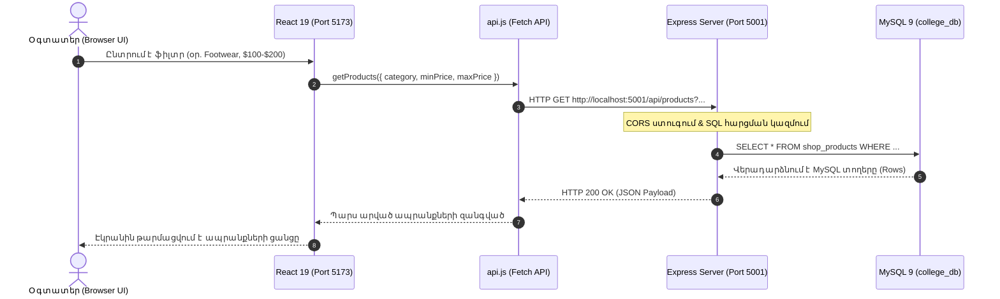

# Տեխնոլոգիական Ընտրության և MySQL Կոնֆիգուրացիայի Բացատրություն
## (Technology Stack, Frontend-Backend Communication & Database Internals)

Այս փաստաթուղթը մանրամասն ներկայացնում է **AURA / ARCHIVE** նախագծի տեխնիկական հիմնավորումները, ծրագրավորման լեզվի ընտրությունը, ֆրոնտենդ-բեքենդ փոխկապակցման մեխանիզմները և MySQL տվյալների բազայի կոնֆիգուրացիոն պարամետրերը (`InnoDB`, `utf8mb4`, `utf8mb4_unicode_ci`)։

---

## 📑 Բովանդակություն
1. [Ինչո՞ւ ընտրեցինք JavaScript (Why Full-Stack JavaScript)](#1-ինչու-ընտրեցինք-javascript-why-full-stack-javascript)
2. [Ինչպե՞ս են կապված Ֆրոնտենդն ու Բեքենդը (Frontend to Backend Connection)](#2-ինչպես-են-կապված-ֆրոնտենդն-ու-բեքենդը-frontend-to-backend-connection)
3. [MySQL Կոնֆիգուրացիոն Հրամանների Խորքային Բացատրություն](#3-mysql-կոնֆիգուրացիոն-հրամանների-խորքային-բացատրություն)
   - [Ի՞նչ է `ENGINE=InnoDB` և ինչո՞ւ հենց InnoDB](#ինչ-է-engineinnodb-և-ինչու-հենց-innodb)
   - [Ի՞նչ է `DEFAULT CHARSET=utf8mb4` և ինչո՞ւ ոչ սովորական utf8](#ինչ-է-default-charsetutf8mb4-և-ինչու-ոչ-սովորական-utf8)
   - [Ի՞նչ է `COLLATE=utf8mb4_unicode_ci`](#ինչ-է-collateutf8mb4_unicode_ci)
4. [Բազայի Դիզայնի Գաղափարախոսությունը (Nike x Zara)](#4-բազայի-դիզայնի-գաղափարախոսությունը-nike-x-zara)

---

## 1. Ինչո՞ւ ընտրեցինք JavaScript (Why Full-Stack JavaScript)

Նախագծում կիրառվել է **Full-Stack JavaScript (Node.js/Express + React/Vite)** մոտեցումը։ Այս ընտրությունն ունի մի շարք առանցքային առավելություններ՝

### 1.1. Միասնական Լեզու Ֆրոնտենդի և Բեքենդի Համար (Unified Ecosystem)
- Ծրագրավորողը և՛ սերվերային մասում (Server-side), և՛ հաճախորդի բրաուզերում (Client-side) օգտագործում է նույն լեզուն՝ JavaScript (ES6+ Modules)։
- Չկա լեզվական «կոնտեքստի անցման» (context switching) խնդիր, ինչպես լինում է, օրինակ, Python/Django + React կամ PHP + Vue համադրություններում։

### 1.2. JSON-ի Բնիկ Ինտեգրում (Native JSON Handling)
- Էլեկտրոնային առևտրի (eCommerce) ապրանքները պարունակում են բարդ կառուցվածքներ՝ չափսեր (`sizes`), գույներ (`colors`), նկարների պատկերասրահ (`gallery`), զամբյուղի պարունակություն (`items`)։
- Քանի որ **JSON (JavaScript Object Notation)** հանդիսանում է JavaScript-ի բնիկ մաս, բեքենդի և ֆրոնտենդի միջև տվյալների փոխանցումը, սերիալիզացիան և պարսինգը կատարվում են առավելագույնս արագ ու հարմարավետ (`JSON.stringify()`, `JSON.parse()`)։

### 1.3. Ասինխրոն I/O և Իրադարձությունների Շարժիչ (Non-blocking Asynchronous I/O)
- Node.js-ի **Event Loop** ճարտարապետությունը հնարավորություն է տալիս սպասարկել միաժամանակյա հազարավոր հարցումներ (հատկապես ապրանքների կատալոգի զննման, ֆիլտրման և պատվերների գրանցման ժամանակ)՝ չարգելափակելով սերվերի հիմնական թելքը (Single-threaded Non-blocking I/O)։

### 1.4. React-ի Ժամանակակից Կոմպոնենտային Ճարտարապետություն (Component-Based UI)
- React-ը թույլ է տալիս կայքը բաժանել ինքնուրույն և վերաօգտագործելի բաղադրիչների (`ProductCard`, `FilterBar`, `AdminModal`, `CartDrawer`):
- Վիճակի (State) ակնթարթային ռեակտիվ թարմացումները գնորդին տալիս են արագագործ Single Page Application (SPA) փորձառություն՝ առանց էջի վերաբեռնման (No Page Reload)։

---

## 2. Ինչպե՞ս են կապված Ֆրոնտենդն ու Բեքենդը (Frontend to Backend Connection)

Ֆրոնտենդի և Բեքենդի փոխկապակցումն իրականացվում է **Client-Server RESTful API** մոդելով՝ HTTP/HTTPS պրոտոկոլի միջոցով։



### Փոխկապակցման Հիմնական Բաղադրիչները՝

1. **HTTP Client (Fetch API — [`client/src/api.js`](file:///Users/aksel/Desktop/college_website_app/client/src/api.js))**:
   - Ֆրոնտենդում կենտրոնացված է `api` օբյեկտը, որտեղ սահմանված են ասինխրոն ֆունկցիաներ (`async/await`):
   - Բոլոր հարցումներն ուղղվում են դեպի `API_BASE = 'http://localhost:5001/api'` հասցեն։
   - Օգտագործվում են ստանդարտ REST մեթոդները՝
     - `GET`: Ապրանքների, պատվերների, վիճակագրության, կարծիքների ստացում։
     - `POST`: Պատվերի ստեղծում, գրանցում, մուտք, նոր ապրանքի ավելացում։
     - `PUT`: Ապրանքի ամբողջական տվյալների խմբագրում։
     - `PATCH`: Պատվերի կարգավիճակի փոփոխում (`paid` ➔ `shipped`), օգտատիրոջ դերի փոփոխում (`customer` ➔ `admin`), կտրոնի ակտիվացում։
     - `DELETE`: Ապրանքի, պատվերի, կարծիքի կամ կտրոնի հեռացում։

2. **CORS (Cross-Origin Resource Sharing)**:
   - Քանի որ ֆրոնտենդն աշխատում է `http://localhost:5173` պորտով, իսկ բեքենդը՝ `http://localhost:5001` պորտով, բրաուզերի անվտանգության համակարգը (Same-Origin Policy) կկասեցներ հարցումները։
   - Սերվերում տեղադրված է `cors()` միջանկյալ ծրագրաշարը (middleware)՝ `server/server.js`-ում, որը թույլատրում է միջտիրույթային անվտանգ հարցումները։

3. **JSON Ֆորմատով Տվյալների Փոխանակում**:
   - Հարցումներում ուղարկվում է Header՝ `'Content-Type': 'application/json'`։
   - Սերվերում `express.json()` միջանկյալ ծրագրաշարը պարսում է մուտքային տվյալները և դարձնում `req.body`:

4. **Անվտանգություն և Աուտենտիֆիկացիա (JWT — JSON Web Tokens)**:
   - Մուտք գործելիս կամ գրանցվելիս սերվերը գեներացնում է գաղտնագրված թվային նշան (Token)։
   - Պաշտպանված հարցումների դեպքում (օր․ հաճախորդի պատվերները տեսնելը կամ Wishlist ավելացնելը) ֆրոնտենդը Token-ն ուղարկում է HTTP Header-ում՝
     `Authorization: Bearer <JWT_TOKEN>`:

---

## 3. MySQL Կոնֆիգուրացիոն Հրամանների Խորքային Բացատրություն

Ստորև ներկայացված է հարցման մեջ նշված հատվածի մանրակրկիտ վերլուծությունը՝

```sql
ENGINE=InnoDB DEFAULT CHARSET=utf8mb4 COLLATE=utf8mb4_unicode_ci;
```

---

### Ի՞նչ է `ENGINE=InnoDB` և ինչո՞ւ հենց InnoDB

MySQL-ում **Storage Engine**-ը (պահպանման շարժիչը) պատասխանատու է տվյալների պահպանման, ինդեքսավորման, կողպման (locking) և կարդալ/գրելու մեխանիզմների համար։

MySQL-ն առաջարկում է մի քանի շարժիչներ (`MyISAM`, `MEMORY`, `InnoDB`, `CSV`), սակայն մեր էլեկտրոնային խանութի համար ընտրվել է **InnoDB**, հետևյալ պատճառներով՝

1. **ACID Համապատասխանություն (Atomicity, Consistency, Isolation, Durability)**:
   - Էլեկտրոնային խանութներում ֆինանսական գործարքների և պատվերների գրանցման ժամանակ կարևորագույն սկզբունքը տրանզակցիաների հուսալիությունն է։
   - Եթե պատվերը ձևակերպվում է, բայց վճարումը կամ ապրանքի քանակի նվազեցումը ձախողվում է, տրանզակցիան հետ է շրջվում (Rollback), ինչը կանխում է տվյալների աղավաղումը։ MyISAM շարժիչը տրանզակցիաներ չի ապահովում, մինչդեռ InnoDB-ն լիարժեք տրանզակցիոն է։

2. **Արտաքին Բանալիների Ամբողջականություն (Foreign Key Constraints)**:
   - InnoDB-ն ապահովում է աղյուսակների միջև խիստ կապեր՝ `FOREIGN KEY`։
   - Մեր համակարգում օգտագործվում են կասկադային գործողություններ՝
     - `ON DELETE CASCADE` (օր․ երբ ապրանքը ջնջվում է, ավտոմատ ջնջվում են դրա հետ կապված wishlist-ի տողերն ու կարծիքները)։
     - `ON DELETE SET NULL` (օր․ երբ օգտատերը ջնջվում է, նրա կատարած պատվերները չեն ոչնչանում, այլ `user_id`-ն դառնում է `NULL`, որպեսզի հաշվապահական և վաճառքի պատմությունը պահպանվի)։
   - MyISAM շարժիչը Foreign Key չի ապահովում (պարզապես անտեսում է դրանք)։

3. **Տողային Մակարդակի Կողպում (Row-Level Locking)**:
   - Երբ մի հաճախորդ պատվիրում է ապրանք, InnoDB-ն կողպում է միայն տվյալ ապրանքի տողը (Row), ոչ թե ամբողջ աղյուսակը (ինչպես անում է MyISAM-ը): Սա ապահովում է հարյուրավոր հաճախորդների միաժամանակյա անխափան աշխատանքը։

4. **Վթարային Վերականգնում (Crash Recovery)**:
   - Սերվերի հոսանքազրկման կամ համակարգչի անջատման դեպքում InnoDB-ն ունի `Redo/Undo` լոգեր, որոնց շնորհիվ բազան վերագործարկվելիս ավտոմատ վերականգնում է չավարտված տվյալները։

---

### Ի՞նչ է `DEFAULT CHARSET=utf8mb4` և ինչո՞ւ ոչ սովորական utf8

MySQL-ում սիմվոլների հավաքածուն (Character Set) սահմանում է, թե ինչպես են տառերն ու նշանները կոդավորվում բայթերով։

Շատերը կարծում են, որ սովորական `utf8` կոդավորումը բավարար է, սակայն MySQL-ում հին `utf8`-ը (որը կոչվում է նաև `utf8mb3`) իրականում կտրված ստանդարտ է և յուրաքանչյուր նշանի համար հատկացնում է առավելագույնը **3 բայթ**։

Մինչդեռ **`utf8mb4`** նշանակում է **UTF-8 4-Bytes per Character** (լիարժեք UTF-8)։

#### Ինչո՞ւ է սա կարևոր մեր eCommerce կայքում՝
1. **Հայերեն և Միջազգային Այբուբենների Անխափան Աջակցություն**:
   - Հայերեն, վրացերեն, արաբերեն, չինարեն և այլ լեզուների սիմվոլները պահանջում են բազմաբայթ կոդավորում։ `utf8mb4`-ը երաշխավորում է, որ հայերեն տեքստերը չեն դառնա հարցական նշաններ (`???`) կամ անհասկանալի նշաններ (`Mojibake`)։
2. **Էմոջիների (Emojis) Լիարժեք Աջակցություն**:
   - Ժամանակակից ապրանքների անվանումներում, ակցիաներում, թեգերում և հաճախորդների կարծիքներում լայնորեն կիրառվում են էմոջիներ (օրինակ՝ 🔥, 👟, 🛍️, ⚡, ⭐):
   - Էմոջիները 4-բայթանոց նշաններ են։ Եթե բազան լիներ սովորական `utf8`, ցանկացած էմոջի պարունակող կարծիք պահպանելիս MySQL-ը կառաջացներ սխալ (`Incorrect string value: '\xF0\x9F\x94\xA5'`) և հարցումը կտապալվեր։ `utf8mb4`-ը լուծում է այս խնդիրը։
3. **Տպագրական Հատուկ Նշաններ**:
   - Էդիտորիալ ոճում կիրառվող հատուկ չակերտները, երկար գծիկները («—», «“», «”») նույնպես պահանջում են 4-բայթ կոդավորում։

---

### Ի՞նչ է `COLLATE=utf8mb4_unicode_ci`

**Collation**-ը (համադրում / տեսակավորում) կանոնների հավաքածու է, որը MySQL-ին ասում է, թե ինչպես պետք է համեմատել (`COMPARE`) և դասավորել (`SORT / ORDER BY`) տեքստային տվյալները։

Բաղադրիչների վերծանումը՝
1. **`utf8mb4`** — Համապատասխանում է մեր ընտրած սիմվոլների հավաքածուին։
2. **`unicode`** — Հիմնված է **Unicode Collation Algorithm (UCA)** միջազգային ստանդարտի վրա։
   - Սա ապահովում է ճիշտ այբբենական դասավորություն տարբեր լեզուների դեպքում (ի տարբերություն հին `utf8mb4_general_ci`-ի, որը կիրառում էր պարզեցված արագացված ալգորիթմ և սխալ էր տեսակավորում որոշ լեզուների հատուկ տառերը)։
3. **`ci` (Case-Insensitive — Ռեգիստրից Անկախ)**:
   - Տեքստային համեմատությունների ժամանակ մեծատառն ու փոքրատառը համարվում են համարժեք։
   - Օրինակ՝ եթե հաճախորդը որոնման դաշտում գրում է `runner`, ապա հարցումը կգտնի նաև `RUNNER` կամ `Runner` բառերը պարունակող ապրանքները։
   - Մուտք գործելիս `Alex@example.com` և `alex@example.com` էլ․ հասցեները կճանաչվեն որպես նույն հաշիվը, ինչը կանխում է կրկնօրինակ հաշիվների ստեղծումը։

---

## 4. Բազայի Դիզայնի Գաղափարախոսությունը (Nike x Zara)

Տվյալների բազայի կառուցվածքն ու նախնական տվյալները (Seed Data) մշակված են այնպես, որ արտացոլեն երկու աշխարհահռչակ բրենդների առանձնահատկությունները՝

1. **Nike (High-Performance Athletics & Quick Actions)**:
   - Տեխնիկական դաշտեր՝ `sizes` (US Footwear չափսեր `US 8`-ից `US 12`), `colors` (Obsidian, Crimson, Volt Neon), `sub_category: 'Footwear'`։
   - Պահեստային հաշվառում՝ `stock_quantity`, որը թույլ է տալիս հետևել արագ վաճառվող սպորտային մոդելների առկայությանը։
   - Անվճար առաքման շեմ ($150) և պատվերի ակնթարթային համարների գեներացիա (`NZ-XXXXXX`)։

2. **Zara (Minimalist Editorial Typography & Studio Collections)**:
   - Էդիտորիալ թեգեր՝ `tag` դաշտում (`STUDIO EDITION`, `LIMITED RUN`, `BESTSELLER`, `ICONIC`, `TIMELESS`)։
   - Գների համեմատություն՝ `original_price` և `price` (ցույց տալու սկզբնական և զեղչված արժեքները)։
   - Բազմաանկյուն պատկերասրահներ՝ `gallery` JSON դաշտով (ստուդիական ֆոտոշարքեր)։
   - Չափսի համապատասխանության հետադարձ կապ՝ `fit_rating` (`Runs Small`, `True to Size`, `Runs Large`)։

---

## 5. Ամփոփում

| Տեխնոլոգիա / Պարամետր | Դերը Համակարգում | Հիմնական Առավելությունը |
| :--- | :--- | :--- |
| **Full-Stack JavaScript** | Ընդհանուր լեզու ֆրոնտենդի և բեքենդի համար | Միասնական մտածողություն, բնիկ JSON մշակում, արագ ասինխրոն աշխատանք |
| **REST API + Fetch** | Կապող կամուրջ UI-ի և Սերվերի միջև | Հստակ ստանդարտացված HTTP մեթոդներ (`GET`, `POST`, `PUT`, `PATCH`, `DELETE`) |
| **CORS** | Անվտանգության թույլտվություն | Հնարավորություն է տալիս React-ին (`:5173`) հաղորդակցվել Express-ի (`:5001`) հետ |
| **`ENGINE=InnoDB`** | MySQL պահպանման շարժիչ | ACID տրանզակցիաներ, Foreign Key-երի լիարժեք հսկողություն, Row-level կողպում |
| **`CHARSET=utf8mb4`** | 4-բայթանոց կոդավորում | Հայերենի, օտար լեզուների և էմոջիների (🔥, 👟) անսխալ պահպանում |
| **`COLLATE=utf8mb4_unicode_ci`** | Տեսակավորման ալգորիթմ | Ճշգրիտ այբբենական դասավորություն և ռեգիստրից անկախ (Case-Insensitive) որոնում |
